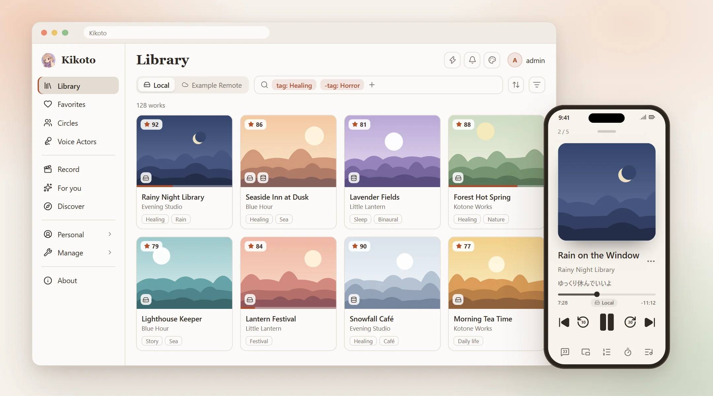

<p align="center">
  
</p>

<h1 align="center">Kikoto</h1>

<p align="center">
  Every audio work you have bought, in one library you host yourself.
</p>

<p align="center">
  <a href="README.md">English</a> ·
  <a href="docs/readme/README.zh-Hans.md">简体中文</a> ·
  <a href="docs/readme/README.zh-Hant.md">繁體中文</a> ·
  <a href="docs/readme/README.ja.md">日本語</a> ·
  <a href="docs/readme/README.ko.md">한국어</a>
</p>

<p align="center">
  <a href="https://github.com/yexca/kikoto/releases"></a>
  <a href="https://kikoto.yexca.net"></a>
  <a href="https://hub.docker.com/r/yexca/kikoto"></a>
  <a href="LICENSE"></a>
</p>

<p align="center">
  <picture>
    <source media="(prefers-color-scheme: dark)" srcset="docs/assets/kikoto-readme-showcase-dark.webp">
    
  </picture>
</p>

Kikoto keeps one entry per work, keyed by its DLsite product code, whether its
files sit in a local folder, on another disk, in the cache, or on a remote
source. It runs on your own server and opens in any browser and in the Android
and iOS apps.

> [!NOTE]
> Kikoto is self-hosted software only and provides no service or content. It
> is designed solely for DLsite works you have purchased yourself; see the
> [Disclaimer](#disclaimer).

## Features

- **Library**: one data directory or a storage pool per disk, search by
  title, circle, voice actor, tag, or staff, and **Manage files** to gather a
  work's scattered copies into one folder.
- **Discover**: new releases from the circles, series, and voice actors you
  subscribe to, DLsite rankings with their history, and **For you** draws from
  your own library.
- **Playback**: one player with progress kept in step across devices,
  server-side conversion for formats the browser cannot play, and a listening
  calendar and reports in **Insights**.
- **Lyrics**: LRC, SRT, WebVTT, and ASS per track and language, speech
  transcription, and AI translation of lyrics, titles, tags, and file names;
  [Kikoto Helper](https://github.com/yexca/kikoto-helper) runs both locally.
- **Record**: a separate library for your own videos, photos, and audio
  files, browsed by folder and played where you stopped.
- **Metadata**: names per language, chosen by each account, and editors for
  titles, covers, tags, credits, and bundles.
- **Remote sources**: browse Kikoeru-compatible sources, then **Track**,
  **Cache**, or **Fetch** what you want.
- **Household**: roles for who may browse, fetch, edit, and administer, and
  long jobs as workflows you can follow and retry.

The [User Guide](docs/user/index.md) describes each of them.

## Install

The image runs on `linux/amd64` and `linux/arm64`, including ARM NAS devices
and 64-bit Raspberry Pi OS. Put [`docker-compose.yml`](docker-compose.yml) in
an empty directory, add your work folders under `data/`, and start Kikoto:

```sh
mkdir config cache data record
docker compose up -d
```

Open <http://127.0.0.1:7655>, enter the setup token from
`docker compose logs kikoto`, and create the administrator; **Set up your
library** runs the first scan. See
[Getting Started](docs/user/en/getting-started.md) for each step.

- **Windows**: [Kikoto Helper](https://github.com/yexca/kikoto-helper) deploys
  and manages Kikoto for you.
- **Android and iOS**: the APK and the unsigned IPA are attached to each
  [release](https://github.com/yexca/kikoto/releases).
- **Upgrade**: back up `config/`, run `docker compose up -d --pull always`,
  and read the [release notes](docs/history/index.md).

> [!WARNING]
> The default port mapping listens on every host interface. Bind it to
> loopback, use a VPN, or put a protected reverse proxy in front; see
> [Security](docs/operations/security.md).

## Documentation

- [User Guide](docs/user/index.md) and [Operations](docs/operations/configuration.md)
- [Architecture](docs/architecture/index.md), starting with
  [Core Boundaries](docs/architecture/core-boundaries.md)
- [Contributing](CONTRIBUTING.md), [Local Development](docs/development/local-dev.md),
  and [Testing](docs/development/testing.md)
- [Security](SECURITY.md) and [Privacy](PRIVACY.md)
- [Documentation Index](docs/README.md)

## Disclaimer

- Kikoto is software only. The project does not host, sell, provide, or
  distribute audio works, metadata, or media files.
- It is designed only for DLsite works you have personally purchased. Follow
  the terms of the stores, sources, and AI services you connect.
- The public demo shows only all-ages, permanently free works.
- Kikoto is not affiliated with or endorsed by DLsite or Kikoeru; their names
  only describe compatibility.
- Each instance's owner is responsible for the sources and services it uses
  and the files added to it.

## License

Copyright (C) 2026 yexca. Kikoto is free software licensed under the
[GNU Affero General Public License v3.0](LICENSE) and comes without warranty.
