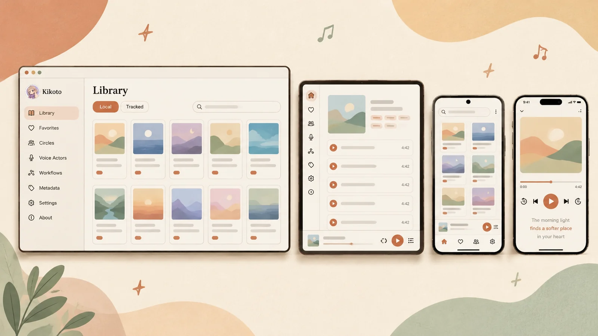
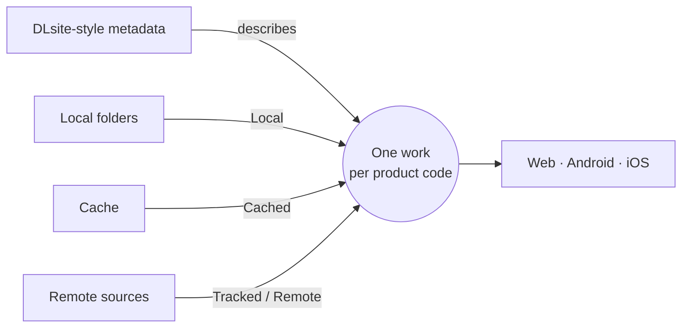

<p align="center">
  
</p>

<h1 align="center">Kikoto</h1>

<p align="center">
  <b>Your purchased audio works, from every folder, cache, and source, in one library.</b><br>
  A local-first, self-hosted library, lyrics workshop, and player.
</p>

<p align="center">
  <a href="README.md">English</a> ·
  <a href="docs/readme/README.zh-Hans.md">简体中文</a> ·
  <a href="docs/readme/README.zh-Hant.md">繁體中文</a> ·
  <a href="docs/readme/README.ja.md">日本語</a> ·
  <a href="docs/readme/README.ko.md">한국어</a>
</p>

<p align="center">
  <a href="https://github.com/yexca/kikoto/releases"></a>
  <a href="https://kikoto.yexca.net"></a>
  <a href="https://hub.docker.com/r/yexca/kikoto"></a>
  <a href="LICENSE"></a>
</p>

Kikoto keeps one entry per work, keyed by its product code, and attaches
DLsite-style metadata, local folders, a rebuildable cache, and
Kikoeru-compatible remote sources to it. It runs on your own server and opens
in any browser and in the Android and iOS apps.

<p align="center">
  
</p>

> [!NOTE]
> Kikoto is self-hosted software only and provides no service or content. It
> is designed solely for DLsite works you have purchased yourself; see the
> [Disclaimer](#disclaimer).

## Features

<table>
  <tr>
    <td width="50%" valign="top">
      <h3>📚 One library, every location</h3>
      Local, cached, tracked, and remote files are states of one work. Use
      one data directory or a <b>storage pool</b> per disk, and
      <b>Edit files</b> to gather scattered copies into one folder.
    </td>
    <td width="50%" valign="top">
      <h3>🌐 Remote sources</h3>
      Browse compatible sources, <b>Track</b> their trees, <b>Cache</b>
      media for playback, or <b>Fetch</b> reviewed files into your library.
    </td>
  </tr>
  <tr>
    <td width="50%" valign="top">
      <h3>🏷️ Metadata in your language</h3>
      Titles, tags, circles, voice actors, and local files carry names per
      language, and each user picks theirs. Editors fix titles, covers, tags,
      credits, and bundle contents.
    </td>
    <td width="50%" valign="top">
      <h3>💬 Lyrics, transcribed and translated</h3>
      Keep lyrics per track and language, transcribe tracks with speech
      recognition, and translate with an LLM. Every result is reviewed, and
      <b>Kikoto Helper</b> runs both locally.
    </td>
  </tr>
  <tr>
    <td width="50%" valign="top">
      <h3>🎧 Listening and Insights</h3>
      A persistent player with synced progress across devices, plus a
      listening calendar, year reports, and a taste profile in
      <b>Insights</b>.
    </td>
    <td width="50%" valign="top">
      <h3>🔔 Subscriptions and smart lists</h3>
      Follow circles, series, and voice actors for new releases, and let smart
      lists fill themselves from tags.
    </td>
  </tr>
</table>

Scans, syncs, file edits, and AI tasks run as workflows you can follow in
Activity, roles decide who may browse, fetch, edit, and administer, and all
state lives in one SQLite database. The APK and IPA for the apps are attached
to each [release](https://github.com/yexca/kikoto/releases).

## How It Works

Metadata describes a work; file sources only say where its audio is. Both
attach to the same work, so caching, fetching, or translating never creates a
second one. See [Core Boundaries](docs/architecture/core-boundaries.md).



## Quick Start

The image runs on `linux/amd64` and `linux/arm64` hosts, including ARM NAS
devices and 64-bit Raspberry Pi OS. With Docker Compose, put
[`docker-compose.yml`](docker-compose.yml) in an empty directory, add your
work folders under `data/`, and start Kikoto:

```sh
mkdir config cache data
docker compose up -d
```

Open <http://127.0.0.1:7655>, enter the setup token from
`docker compose logs kikoto`, and create the administrator. **Set up your
library** then runs the first scan. On Windows,
[Kikoto Helper](https://github.com/yexca/kikoto-helper) does all of this for
you. [Getting Started](docs/user/en/getting-started.md) covers each step.

> [!WARNING]
> The default port mapping listens on every host interface. Bind it to
> loopback, use a VPN, or put a protected reverse proxy in front; see
> [Security](docs/operations/security.md).

Back up `config/` before upgrading, then run
`docker compose up -d --pull always` and read the
[release notes](docs/history/index.md). Settings in `.env` are described in
[Docker](docs/operations/docker.md#configure-with-env).

## Documentation

- [User Guide](docs/user/index.md): library, sources, lyrics, playback,
  subscriptions, and settings.
- [Operations](docs/operations/configuration.md): configuring and running an
  instance.
- [Architecture](docs/architecture/index.md): data and system boundaries.
- [Contributing](CONTRIBUTING.md), [Local Development](docs/development/local-dev.md),
  and [Testing](docs/development/testing.md).
- [Security](SECURITY.md) and [Privacy](PRIVACY.md), including how to report a
  vulnerability.
- [Documentation Index](docs/README.md): every public document.

## Disclaimer

- Kikoto is software only. The project does not host, sell, provide, or
  distribute audio works, metadata, or media files.
- It is designed only for DLsite works you have personally purchased. Follow
  the terms of the stores, sources, and AI services you connect.
- The public demo shows only all-ages, permanently free works.
- Kikoto is not affiliated with or endorsed by DLsite or Kikoeru; their names
  only describe compatibility.
- Each instance's owner is responsible for the sources and services it uses
  and the files added to it.

## License

Copyright (C) 2026 yexca. Kikoto is free software licensed under the
[GNU Affero General Public License v3.0](LICENSE) and comes without warranty.
