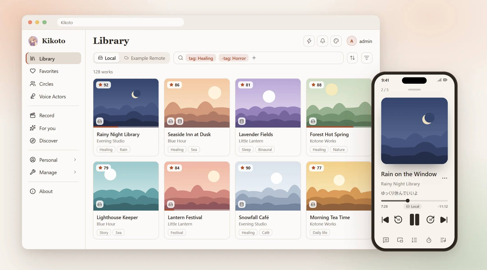

<p align="center">
  
</p>

<h1 align="center">Kikoto</h1>

<p align="center">
  購入した音声作品のすべてを、ご自身でホストするひとつのライブラリへ。
</p>

<p align="center">
  <a href="../../README.md">English</a> ·
  <a href="README.zh-Hans.md">简体中文</a> ·
  <a href="README.zh-Hant.md">繁體中文</a> ·
  <a href="README.ja.md">日本語</a> ·
  <a href="README.ko.md">한국어</a>
</p>

<p align="center">
  <a href="https://github.com/yexca/kikoto/releases"></a>
  <a href="https://kikoto.yexca.net"></a>
  <a href="https://hub.docker.com/r/yexca/kikoto"></a>
  <a href="../../LICENSE"></a>
</p>

<p align="center">
  <picture>
    <source media="(prefers-color-scheme: dark)" srcset="../assets/kikoto-readme-showcase-dark.webp">
    
  </picture>
</p>

Kikoto は、ファイルがローカルフォルダー、別のディスク、キャッシュ、リモートソースのどこにあっても、DLsite の商品コードをキーとして作品ごとに 1 つの項目を保持します。ご自身のサーバーで動作し、あらゆるブラウザーと Android・iOS アプリで開けます。

> [!NOTE]
> Kikoto はセルフホスト型のソフトウェアにすぎません。サービスやコンテンツを一切提供せず、ご自身で購入した DLsite の作品のためだけに設計されています。[免責事項](#免責事項)を参照してください。

## 主な特長

- **ライブラリ**: 1 つのデータディレクトリまたはディスクごとのストレージプール、タイトル・サークル・声優・タグ・スタッフでの検索、そして **ファイルを管理** で作品の散らばったコピーを 1 つのフォルダーに集められます。
- **見つける**: 購読しているサークル、シリーズ、声優の新作、履歴付きの DLsite ランキング、そしてご自身のライブラリから選ばれる **あなた向け**。
- **再生**: 端末間で進捗が同期される 1 つのプレーヤー、ブラウザーで再生できない形式のサーバー側変換、そして **インサイト** の聴取カレンダーとレポート。
- **歌詞**: トラックと言語ごとの LRC、SRT、WebVTT、ASS、音声認識による文字起こし、歌詞・タイトル・タグ・ファイル名の AI 翻訳。[Kikoto Helper](https://github.com/yexca/kikoto-helper) は文字起こしと翻訳の両方をローカルで実行します。
- **メタデータ**: アカウントごとに選べる言語別の名前と、タイトル、カバー、タグ、クレジット、バンドルのエディター。
- **リモートソース**: Kikoeru 互換のソースを閲覧し、必要なものを **追跡**、**キャッシュ**、**取得** できます。
- **世帯での利用**: 閲覧、取得、編集、管理ができる人を決めるロールと、進捗を確認して再試行できるワークフローとして実行される長時間のジョブ。

それぞれの機能は[ユーザーガイド](../user/index.md)で説明しています。

## インストール

イメージは `linux/amd64` と `linux/arm64` で動作し、ARM 版の NAS や 64 ビット版 Raspberry Pi OS でも使えます。空のディレクトリに [`docker-compose.yml`](../../docker-compose.yml) を置き、作品のフォルダーを `data/` の下に追加して、Kikoto を起動します。

```sh
mkdir config cache data
docker compose up -d
```

<http://127.0.0.1:7655> を開き、`docker compose logs kikoto` に表示されるセットアップトークンを入力して、管理者を作成します。続いて **ライブラリを設定** が最初のスキャンを実行します。各手順は[はじめに](../user/ja/getting-started.md)で説明しています。

- **Windows**: [Kikoto Helper](https://github.com/yexca/kikoto-helper) が Kikoto のデプロイと管理を行います。
- **Android と iOS**: APK と未署名の IPA が、各[リリース](https://github.com/yexca/kikoto/releases)に添付されています。
- **アップグレード**: `config/` をバックアップし、`docker compose up -d --pull always` を実行して、[リリースノート](../history/index.md)を確認してください。

> [!WARNING]
> 既定のポートマッピングは、すべてのホストインターフェースで待ち受けます。ループバックにバインドするか、VPN を使うか、保護されたリバースプロキシを前段に置いてください。[セキュリティ](../operations/security.md)を参照してください。

## ドキュメント

- [ユーザーガイド](../user/index.md)と[運用](../operations/configuration.md)
- [アーキテクチャ](../architecture/index.md)。まず[コアの境界](../architecture/core-boundaries.md)から
- [コントリビューション](../../CONTRIBUTING.md)、[ローカル開発](../development/local-dev.md)、[テスト](../development/testing.md)
- [セキュリティ](../../SECURITY.md)と[プライバシー](../../PRIVACY.md)
- [ドキュメントインデックス](../README.md)

## 免責事項

- Kikoto はソフトウェアのみです。このプロジェクトは、音声作品、メタデータ、メディアファイルのホスティング、販売、提供、配布を行いません。
- Kikoto は、ご自身で購入した DLsite の作品のためだけに設計されています。接続するストア、ソース、AI サービスの利用規約に従ってください。
- 公開デモには、全年齢向けで恒久的に無料の作品のみが表示されます。
- Kikoto は DLsite や Kikoeru と提携しておらず、承認も受けていません。これらの名称は、互換性を説明するためにのみ使用しています。
- 各インスタンスの所有者は、利用するソースやサービス、追加したファイルについて責任を負います。

## ライセンス

Copyright (C) 2026 yexca. Kikoto は [GNU Affero General Public License v3.0](../../LICENSE) の下でライセンスされるフリーソフトウェアであり、無保証です。
