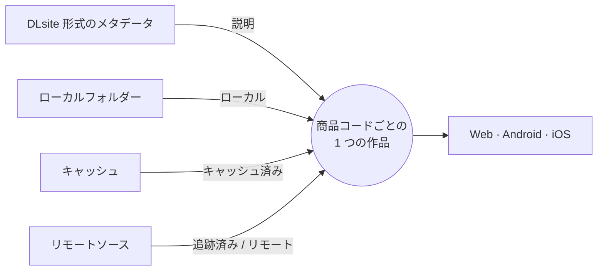

<p align="center">
  
</p>

<h1 align="center">Kikoto</h1>

<p align="center">
  <b>購入した音声作品を、あらゆるフォルダー、キャッシュ、ソースから、ひとつのライブラリへ。</b><br>
  ローカル優先のセルフホスト型ライブラリ、歌詞ワークショップ、プレーヤーです。
</p>

<p align="center">
  <a href="../../README.md">English</a> ·
  <a href="README.zh-Hans.md">简体中文</a> ·
  <a href="README.zh-Hant.md">繁體中文</a> ·
  <a href="README.ja.md">日本語</a> ·
  <a href="README.ko.md">한국어</a>
</p>

<p align="center">
  <a href="https://github.com/yexca/kikoto/releases"></a>
  <a href="https://kikoto.yexca.net"></a>
  <a href="https://hub.docker.com/r/yexca/kikoto"></a>
  <a href="../../LICENSE"></a>
</p>

Kikoto は作品ごとに商品コードをキーとする 1 つの項目を保持し、そこに DLsite 形式のメタデータ、ローカルフォルダー、再構築可能なキャッシュ、Kikoeru 互換のリモートソースを紐付けます。ご自身のサーバーで動作し、あらゆるブラウザーと Android・iOS アプリで開けます。

<p align="center">
  
</p>

> [!NOTE]
> Kikoto はセルフホスト型のソフトウェアにすぎません。サービスやコンテンツを一切提供せず、ご自身で購入した DLsite の作品のためだけに設計されています。[免責事項](#免責事項)を参照してください。

## 主な特長

<table>
  <tr>
    <td width="50%" valign="top">
      <h3>📚 1 つのライブラリ、あらゆる場所</h3>
      ローカル、キャッシュ、追跡済み、リモートのファイルは、1 つの作品の状態です。1 つのデータディレクトリを使うことも、ディスクごとの<b>ストレージプール</b>を使うこともでき、<b>ファイルを編集</b>で散らばったコピーを 1 つのフォルダーに集められます。
    </td>
    <td width="50%" valign="top">
      <h3>🌐 リモートソース</h3>
      互換性のあるソースを閲覧し、そのツリーを<b>追跡</b>し、再生用にメディアを<b>キャッシュ</b>し、確認済みのファイルをライブラリへ<b>取得</b>できます。
    </td>
  </tr>
  <tr>
    <td width="50%" valign="top">
      <h3>🏷️ 使用言語に合わせたメタデータ</h3>
      タイトル、タグ、サークル、声優、ローカルファイルは言語ごとの名前を持ち、ユーザーごとに言語を選べます。編集者は、タイトル、カバー、タグ、クレジット、バンドルの内容を修正できます。
    </td>
    <td width="50%" valign="top">
      <h3>💬 文字起こしと翻訳をした歌詞</h3>
      歌詞をトラックと言語ごとに保持し、音声認識でトラックを文字起こしし、LLM で翻訳できます。結果はすべて確認でき、<b>Kikoto Helper</b> はどちらもローカルで実行します。
    </td>
  </tr>
  <tr>
    <td width="50%" valign="top">
      <h3>🎧 聴取とインサイト</h3>
      端末間で進捗が同期される常駐型のプレーヤーに加え、<b>インサイト</b>には聴取カレンダー、年間レポート、好みのプロフィールがあります。
    </td>
    <td width="50%" valign="top">
      <h3>🔔 サブスクリプションとスマートリスト</h3>
      サークル、シリーズ、声優をフォローして新作を知り、スマートリストにタグから自動で作品を集められます。
    </td>
  </tr>
</table>

スキャン、同期、ファイル編集、AI タスクは、アクティビティで追跡できるワークフローとして実行されます。ロールによって、閲覧、取得、編集、管理ができる人が決まり、すべての状態は 1 つの SQLite データベースに保存されます。アプリの APK と IPA は、各[リリース](https://github.com/yexca/kikoto/releases)に添付されています。

## 仕組み

メタデータは作品を説明し、ファイルソースは、その音声がどこにあるかを示すだけです。どちらも同じ作品に紐付けられるため、キャッシュ、取得、翻訳をしても 2 つ目の作品が作られることはありません。[コアの境界](../architecture/core-boundaries.md)を参照してください。



## クイックスタート

イメージは `linux/amd64` と `linux/arm64` のホストで動作し、ARM 版の NAS や 64 ビット版 Raspberry Pi OS でも使えます。Docker Compose を使う場合は、空のディレクトリに [`docker-compose.yml`](../../docker-compose.yml) を置き、作品のフォルダーを `data/` の下に追加して、Kikoto を起動します。

```sh
mkdir config cache data
docker compose up -d
```

<http://127.0.0.1:7655> を開き、`docker compose logs kikoto` に表示されるセットアップトークンを入力して、管理者を作成します。続いて **ライブラリを設定** が最初のスキャンを実行します。Windows では、[Kikoto Helper](https://github.com/yexca/kikoto-helper)がこれらをすべて行います。各手順は[はじめに](../user/ja/getting-started.md)で説明しています。

> [!WARNING]
> 既定のポートマッピングは、すべてのホストインターフェースで待ち受けます。ループバックにバインドするか、VPN を使うか、保護されたリバースプロキシを前段に置いてください。[セキュリティ](../operations/security.md)を参照してください。

アップグレードの前に `config/` をバックアップし、`docker compose up -d --pull always` を実行して、[リリースノート](../history/index.md)を確認してください。`.env` の設定は [Docker](../operations/docker.md#configure-with-env) で説明しています。

## ドキュメント

- [ユーザーガイド](../user/ja/index.md): ライブラリ、ソース、歌詞、再生、サブスクリプション、設定。
- [運用](../operations/configuration.md): インスタンスの構成と運用。
- [アーキテクチャ](../architecture/index.md): データとシステムの境界。
- [コントリビューション](../../CONTRIBUTING.md)、[ローカル開発](../development/local-dev.md)、[テスト](../development/testing.md)。
- [セキュリティ](../../SECURITY.md)と[プライバシー](../../PRIVACY.md)。脆弱性の報告方法も含みます。
- [ドキュメントインデックス](../README.md): すべての公開ドキュメント。

## 免責事項

- Kikoto はソフトウェアのみです。このプロジェクトは、音声作品、メタデータ、メディアファイルのホスティング、販売、提供、配布を行いません。
- Kikoto は、ご自身で購入した DLsite の作品のためだけに設計されています。接続するストア、ソース、AI サービスの利用規約に従ってください。
- 公開デモには、全年齢向けで恒久的に無料の作品のみが表示されます。
- Kikoto は DLsite や Kikoeru と提携しておらず、承認も受けていません。これらの名称は、互換性を説明するためにのみ使用しています。
- 各インスタンスの所有者は、利用するソースやサービス、追加したファイルについて責任を負います。

## ライセンス

Copyright (C) 2026 yexca. Kikoto は [GNU Affero General Public License v3.0](../../LICENSE) の下でライセンスされるフリーソフトウェアであり、無保証です。
