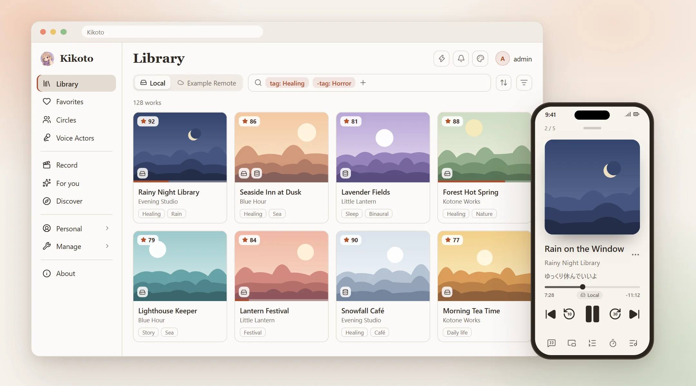

<p align="center">
  
</p>

<h1 align="center">Kikoto</h1>

<p align="center">
  구매한 모든 음성 작품을, 직접 호스팅하는 하나의 라이브러리에.
</p>

<p align="center">
  <a href="../../README.md">English</a> ·
  <a href="README.zh-Hans.md">简体中文</a> ·
  <a href="README.zh-Hant.md">繁體中文</a> ·
  <a href="README.ja.md">日本語</a> ·
  <a href="README.ko.md">한국어</a>
</p>

<p align="center">
  <a href="https://github.com/yexca/kikoto/releases"></a>
  <a href="https://kikoto.yexca.net"></a>
  <a href="https://hub.docker.com/r/yexca/kikoto"></a>
  <a href="../../LICENSE"></a>
</p>

<p align="center">
  
</p>

Kikoto는 파일이 로컬 폴더, 다른 디스크, 캐시, 원격 소스 중 어디에 있든 DLsite
상품 코드를 키로 작품당 하나의 항목을 유지합니다. 사용자의 서버에서 실행되며
모든 브라우저와 Android, iOS 앱에서 열 수 있습니다.

> [!NOTE]
> Kikoto는 셀프 호스팅 소프트웨어일 뿐이며 어떠한 서비스나 콘텐츠도 제공하지
> 않습니다. 사용자가 직접 구매한 DLsite 작품만을 위해 설계되었습니다.
> [면책 조항](#면책-조항)을 참고하세요.

## 주요 특징

- **라이브러리**: 데이터 디렉터리 하나 또는 디스크마다 스토리지 풀, 제목, 서클,
  성우, 태그, 스태프로 검색, 그리고 **파일 관리**로 흩어진 작품 사본을 한
  폴더로 모으기.
- **둘러보기**: 구독 중인 서클, 시리즈, 성우의 신작, 기록이 남는 DLsite 순위,
  내 라이브러리에서 뽑는 **맞춤 추천**.
- **재생**: 기기 간에 진행 상황이 동기화되는 하나의 플레이어, 브라우저가 재생할
  수 없는 형식을 위한 서버 측 변환, **인사이트**의 청취 달력과 보고서.
- **가사**: 트랙과 언어마다 LRC, SRT, WebVTT, ASS, 음성 인식 전사, 가사, 제목,
  태그, 파일 이름의 AI 번역. [Kikoto Helper](https://github.com/yexca/kikoto-helper)가
  둘 다 로컬에서 실행합니다.
- **메타데이터**: 계정마다 고르는 언어별 이름, 그리고 제목, 표지, 태그, 크레딧,
  묶음 편집기.
- **원격 소스**: Kikoeru 호환 소스를 탐색한 뒤 원하는 것을 **추적**, **캐시**,
  **가져오기**.
- **가족**: 탐색, 가져오기, 편집, 관리를 할 수 있는 사람을 정하는 역할, 그리고
  따라가고 다시 시도할 수 있는 워크플로로 실행되는 긴 작업.

각 기능은 [사용자 가이드](../user/index.md)에서 설명합니다.

## 설치

이미지는 ARM NAS 기기와 64비트 Raspberry Pi OS를 포함한 `linux/amd64` 및
`linux/arm64`에서 실행됩니다. 빈 디렉터리에
[`docker-compose.yml`](../../docker-compose.yml)을 두고, 작품 폴더를 `data/`
아래에 추가한 다음 Kikoto를 시작하세요.

```sh
mkdir config cache data
docker compose up -d
```

<http://127.0.0.1:7655>를 열고 `docker compose logs kikoto`에 나오는 설정 토큰을
입력한 뒤 관리자를 만드세요. 그러면 **라이브러리 설정**이 첫 스캔을 실행합니다.
각 단계는 [시작하기](../user/ko/getting-started.md)를 참고하세요.

- **Windows**: [Kikoto Helper](https://github.com/yexca/kikoto-helper)가 Kikoto를
  대신 배포하고 관리합니다.
- **Android와 iOS**: APK와 서명되지 않은 IPA가 각
  [릴리스](https://github.com/yexca/kikoto/releases)에 첨부됩니다.
- **업그레이드**: `config/`를 백업하고 `docker compose up -d --pull always`를
  실행한 다음 [릴리스 노트](../history/index.md)를 읽으세요.

> [!WARNING]
> 기본 포트 매핑은 모든 호스트 인터페이스에서 수신 대기합니다. 루프백에
> 바인딩하거나, VPN을 사용하거나, 보호된 리버스 프록시를 앞에 두세요.
> [보안](../operations/security.md)을 참고하세요.

## 문서

- [사용자 가이드](../user/index.md)와 [운영](../operations/configuration.md)
- [아키텍처](../architecture/index.md), 시작은
  [핵심 경계](../architecture/core-boundaries.md)
- [기여하기](../../CONTRIBUTING.md), [로컬 개발](../development/local-dev.md),
  [테스트](../development/testing.md)
- [보안](../../SECURITY.md)과 [개인정보](../../PRIVACY.md)
- [문서 색인](../README.md)

## 면책 조항

- Kikoto는 소프트웨어일 뿐입니다. 이 프로젝트는 음성 작품, 메타데이터, 미디어
  파일을 호스팅하거나 판매, 제공, 배포하지 않습니다.
- 사용자가 직접 구매한 DLsite 작품만을 위해 설계되었습니다. 연결하는 상점, 소스,
  AI 서비스의 약관을 따르세요.
- 공개 데모는 전 연령 대상이고 영구적으로 무료인 작품만 보여 줍니다.
- Kikoto는 DLsite 또는 Kikoeru와 제휴하거나 보증을 받지 않았습니다. 이들의
  이름은 호환성을 설명하는 데만 사용됩니다.
- 각 인스턴스의 소유자는 인스턴스가 사용하는 소스와 서비스, 그리고 추가된
  파일에 대한 책임을 집니다.

## 라이선스

Copyright (C) 2026 yexca. Kikoto는
[GNU Affero General Public License v3.0](../../LICENSE)에 따라 라이선스가 부여된
자유 소프트웨어이며 어떠한 보증도 제공하지 않습니다.
