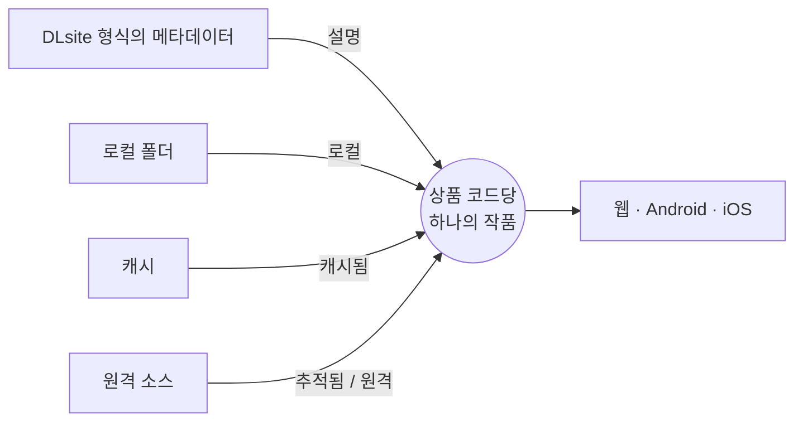

<p align="center">
  
</p>

<h1 align="center">Kikoto</h1>

<p align="center">
  <b>구매한 음성 작품을 모든 폴더, 캐시, 소스에서 하나의 라이브러리로.</b><br>
  로컬 우선의 셀프 호스팅 라이브러리, 가사 작업실, 플레이어입니다.
</p>

<p align="center">
  <a href="../../README.md">English</a> ·
  <a href="README.zh-Hans.md">简体中文</a> ·
  <a href="README.zh-Hant.md">繁體中文</a> ·
  <a href="README.ja.md">日本語</a> ·
  <a href="README.ko.md">한국어</a>
</p>

<p align="center">
  <a href="https://github.com/yexca/kikoto/releases"></a>
  <a href="https://kikoto.yexca.net"></a>
  <a href="https://hub.docker.com/r/yexca/kikoto"></a>
  <a href="../../LICENSE"></a>
</p>

Kikoto는 상품 코드를 키로 작품당 하나의 항목을 유지하고, 여기에 DLsite 형식의
메타데이터, 로컬 폴더, 다시 만들 수 있는 캐시, Kikoeru 호환 원격 소스를
연결합니다. 사용자의 서버에서 실행되며 모든 브라우저와 Android, iOS 앱에서 열 수
있습니다.

<p align="center">
  
</p>

> [!NOTE]
> Kikoto는 셀프 호스팅 소프트웨어일 뿐이며 어떠한 서비스나 콘텐츠도 제공하지
> 않습니다. 사용자가 직접 구매한 DLsite 작품만을 위해 설계되었습니다.
> [면책 조항](#면책-조항)을 참고하세요.

## 주요 특징

<table>
  <tr>
    <td width="50%" valign="top">
      <h3>📚 하나의 라이브러리, 여러 위치</h3>
      로컬, 캐시, 추적, 원격 파일은 하나의 작품이 가진 상태입니다. 데이터
      디렉터리 하나를 사용하거나 디스크마다 <b>스토리지 풀</b>을 두고,
      <b>파일 관리</b>로 흩어진 사본을 한 폴더로 모을 수 있습니다.
    </td>
    <td width="50%" valign="top">
      <h3>🌐 원격 소스</h3>
      호환되는 소스를 탐색하고, 디렉터리 트리를 <b>추적</b>하거나, 재생을 위해
      미디어를 <b>캐시</b>하거나, 검토를 마친 파일을 라이브러리로
      <b>가져오기</b>할 수 있습니다.
    </td>
  </tr>
  <tr>
    <td width="50%" valign="top">
      <h3>🏷️ 내 언어로 보는 메타데이터</h3>
      제목, 태그, 서클, 성우, 로컬 파일에는 언어별 이름이 있으며, 사용자마다
      자신의 언어를 고릅니다. 편집자는 제목, 표지, 태그, 크레딧, 묶음 구성을 바로잡습니다.
    </td>
    <td width="50%" valign="top">
      <h3>💬 전사와 번역을 거치는 가사</h3>
      트랙과 언어마다 가사를 보관하고, 음성 인식으로 트랙을 전사하고, LLM으로
      번역합니다. 모든 결과는 검토를 거치며, <b>Kikoto Helper</b>가 둘 다
      로컬에서 실행합니다.
    </td>
  </tr>
  <tr>
    <td width="50%" valign="top">
      <h3>🎧 청취와 인사이트</h3>
      기기 간에 진행 상황이 동기화되는 지속형 플레이어와, <b>인사이트</b>의 청취
      달력, 연간 보고서, 취향 프로필을 제공합니다.
    </td>
    <td width="50%" valign="top">
      <h3>🔔 구독과 스마트 목록</h3>
      서클, 시리즈, 성우를 팔로우해 신작을 받아보고, 스마트 목록이 태그에서
      스스로 채워지게 합니다.
    </td>
  </tr>
</table>

스캔, 동기화, 파일 편집, AI 작업은 활동에서 따라갈 수 있는 워크플로로 실행되고,
역할이 탐색, 가져오기, 편집, 관리를 할 수 있는 사람을 결정하며, 모든 상태는
하나의 SQLite 데이터베이스에 저장됩니다. 앱의 APK와 IPA는 각
[릴리스](https://github.com/yexca/kikoto/releases)에 첨부됩니다.

## 작동 방식

메타데이터는 작품을 설명하고, 파일 소스는 오디오가 어디에 있는지만 알려 줍니다.
둘 다 같은 작품에 연결되므로 캐시, 가져오기, 번역이 두 번째 작품을 만들지
않습니다. [핵심 경계](../architecture/core-boundaries.md)를 참고하세요.



## 빠른 시작

이미지는 ARM NAS 기기와 64비트 Raspberry Pi OS를 포함한 `linux/amd64` 및
`linux/arm64` 호스트에서 실행됩니다. Docker Compose를 사용한다면 빈 디렉터리에
[`docker-compose.yml`](../../docker-compose.yml)을 두고, 작품 폴더를 `data/` 아래에 추가한 다음 Kikoto를 시작하세요.

```sh
mkdir config cache data
docker compose up -d
```

<http://127.0.0.1:7655>를 열고 `docker compose logs kikoto`에 나오는 설정 토큰을
입력한 뒤 관리자를 만드세요. 그러면 **라이브러리 설정**이 첫 스캔을 실행합니다.
Windows에서는 [Kikoto Helper](https://github.com/yexca/kikoto-helper)가 이 모든
과정을 대신해 줍니다. 각 단계는 [시작하기](../user/ko/getting-started.md)에서
설명합니다.

> [!WARNING]
> 기본 포트 매핑은 모든 호스트 인터페이스에서 수신 대기합니다. 루프백에
> 바인딩하거나, VPN을 사용하거나, 보호된 리버스 프록시를 앞에 두세요.
> [보안](../operations/security.md)을 참고하세요.

업그레이드하기 전에 `config/`를 백업한 다음
`docker compose up -d --pull always`를 실행하고
[릴리스 노트](../history/index.md)를 읽으세요. `.env`의 설정은
[Docker](../operations/docker.md#configure-with-env)에서 설명합니다.

## 문서

- [사용자 가이드](../user/index.md): 라이브러리, 소스, 가사, 재생, 구독, 설정.
- [운영](../operations/configuration.md): 인스턴스 구성 및 운영.
- [아키텍처](../architecture/index.md): 데이터와 시스템 경계.
- [기여하기](../../CONTRIBUTING.md), [로컬 개발](../development/local-dev.md),
  [테스트](../development/testing.md).
- [보안](../../SECURITY.md)과 [개인정보](../../PRIVACY.md): 취약점 신고 방법
  포함.
- [문서 색인](../README.md): 모든 공개 문서.

## 면책 조항

- Kikoto는 소프트웨어일 뿐입니다. 이 프로젝트는 음성 작품, 메타데이터, 미디어
  파일을 호스팅하거나 판매, 제공, 배포하지 않습니다.
- 사용자가 직접 구매한 DLsite 작품만을 위해 설계되었습니다. 연결하는 상점, 소스,
  AI 서비스의 약관을 따르세요.
- 공개 데모는 전 연령 대상이고 영구적으로 무료인 작품만 보여 줍니다.
- Kikoto는 DLsite 또는 Kikoeru와 제휴하거나 보증을 받지 않았습니다. 이들의
  이름은 호환성을 설명하는 데만 사용됩니다.
- 각 인스턴스의 소유자는 인스턴스가 사용하는 소스와 서비스, 그리고 추가된
  파일에 대한 책임을 집니다.

## 라이선스

Copyright (C) 2026 yexca. Kikoto는
[GNU Affero General Public License v3.0](../../LICENSE)에 따라 라이선스가 부여된
자유 소프트웨어이며 어떠한 보증도 제공하지 않습니다.
