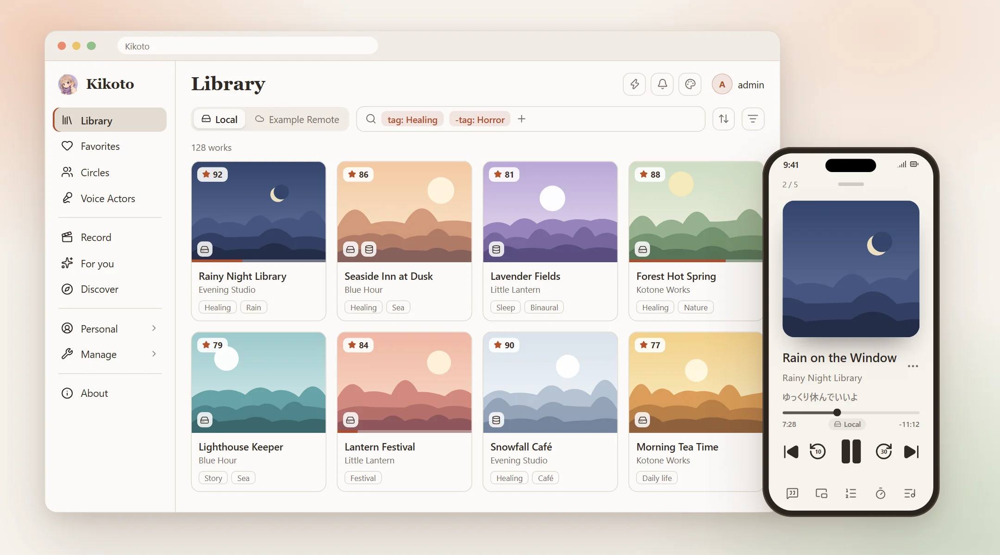

<p align="center">
  
</p>

<h1 align="center">Kikoto</h1>

<p align="center">
  你购买的每一部音频作品，都汇集在一个由你自己托管的媒体库中。
</p>

<p align="center">
  <a href="../../README.md">English</a> ·
  <a href="README.zh-Hans.md">简体中文</a> ·
  <a href="README.zh-Hant.md">繁體中文</a> ·
  <a href="README.ja.md">日本語</a> ·
  <a href="README.ko.md">한국어</a>
</p>

<p align="center">
  <a href="https://github.com/yexca/kikoto/releases"></a>
  <a href="https://kikoto.yexca.net"></a>
  <a href="https://hub.docker.com/r/yexca/kikoto"></a>
  <a href="../../LICENSE"></a>
</p>

<p align="center">
  <picture>
    <source media="(prefers-color-scheme: dark)" srcset="../assets/kikoto-readme-showcase-dark.webp">
    
  </picture>
</p>

Kikoto 为每部作品只保留一个条目，以其 DLsite 商品编号为键，无论它的文件位于本地文件夹、另一块磁盘、缓存还是远程来源。它运行在你自己的服务器上，可在任何浏览器以及 Android 和 iOS 应用中打开。

> [!NOTE]
> Kikoto 只是自托管软件，不提供任何服务或内容，仅用于你自己购买的 DLsite 作品；参见[免责声明](#免责声明)。

## 功能特性

- **媒体库**：使用单一的数据目录，或为每块磁盘使用一个存储池，可按标题、社团、声优、标签或制作人员搜索，并用**管理文件**把一部作品分散的副本收集到同一个文件夹。
- **发现**：你所订阅的社团、系列和声优的新作，DLsite 排行榜及其历史，以及从你自己媒体库中抽取作品的**为你推荐**。
- **播放**：一个播放器，播放进度在各设备间保持同步，对浏览器无法播放的格式在服务器端转换，并在**数据面板**中提供收听日历和报告。
- **歌词**：按音轨和语言保存 LRC、SRT、WebVTT 和 ASS 歌词，支持语音转写，以及歌词、标题、标签和文件名的 AI 翻译；[Kikoto Helper](https://github.com/yexca/kikoto-helper) 可在本地运行这两者。
- **元数据**：按语言保存名称，由每个账号自行选择，并提供标题、封面、标签、署名信息和合集的编辑器。
- **远程来源**：浏览兼容 Kikoeru 的来源，然后**跟踪**、**缓存**或**获取**你想要的内容。
- **家庭共用**：用角色决定谁可以浏览、获取、编辑和管理，长时间任务以工作流的形式运行，可以查看进度并重试。

[用户指南](../user/index.md)介绍了其中的每一项。

## 安装

镜像可在 `linux/amd64` 和 `linux/arm64` 主机上运行，包括 ARM NAS 设备和 64 位 Raspberry Pi OS。把 [`docker-compose.yml`](../../docker-compose.yml) 放到一个空目录中，把作品文件夹添加到 `data/` 下，然后启动 Kikoto：

```sh
mkdir config cache data
docker compose up -d
```

打开 <http://127.0.0.1:7655>，输入 `docker compose logs kikoto` 中的初始化令牌，并创建管理员；随后**设置媒体库**会运行首次扫描。每一步的说明参见[入门指南](../user/zh-Hans/getting-started.md)。

- **Windows**：[Kikoto Helper](https://github.com/yexca/kikoto-helper) 会为你部署和管理 Kikoto。
- **Android 和 iOS**：APK 和未签名的 IPA 会附在每个[发布版本](https://github.com/yexca/kikoto/releases)中。
- **升级**：备份 `config/`，运行 `docker compose up -d --pull always`，并阅读[发布说明](../history/index.md)。

> [!WARNING]
> 默认的端口映射会监听主机的所有网络接口。请把它绑定到回环地址、使用 VPN，或在前面放置受保护的反向代理；参见[安全](../operations/security.md)。

## 文档

- [用户指南](../user/index.md)和[运维](../operations/configuration.md)
- [架构](../architecture/index.md)，从[核心边界](../architecture/core-boundaries.md)开始
- [贡献指南](../../CONTRIBUTING.md)、[本地开发](../development/local-dev.md)和[测试](../development/testing.md)
- [安全](../../SECURITY.md)和[隐私](../../PRIVACY.md)
- [文档索引](../README.md)

## 免责声明

- Kikoto 只是软件。本项目不托管、销售、提供或分发音频作品、元数据或媒体文件。
- 它仅用于你本人购买的 DLsite 作品。请遵守你所连接的商店、来源和 AI 服务的条款。
- 公开演示只显示适合所有年龄段且永久免费的作品。
- Kikoto 与 DLsite 或 Kikoeru 没有隶属关系，也未获得它们的认可；文中使用它们的名称仅是为了说明兼容性。
- 每个实例的所有者对其使用的来源和服务，以及添加到其中的文件负责。

## 许可证

版权所有 (C) 2026 yexca。Kikoto 是依据 [GNU Affero General Public License v3.0](../../LICENSE) 授权的自由软件，不提供任何担保。
