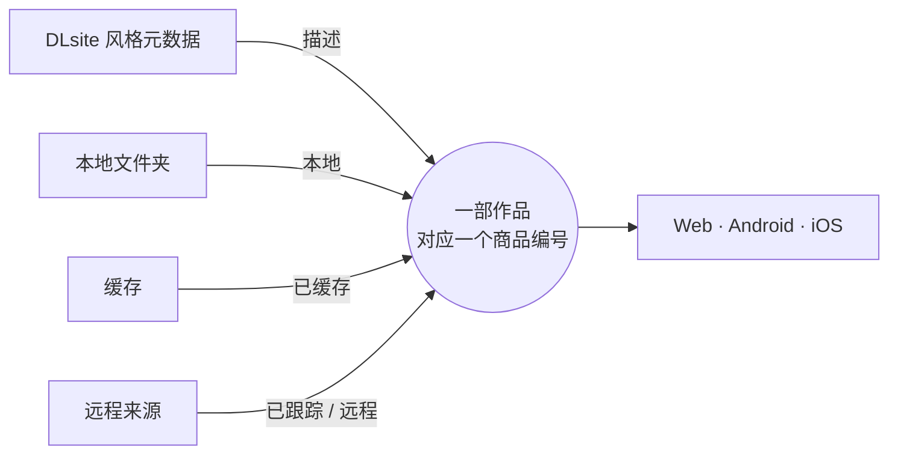

<p align="center">
  
</p>

<h1 align="center">Kikoto</h1>

<p align="center">
  <b>你购买的音频作品，无论来自哪个文件夹、缓存或来源，都汇集在同一个媒体库中。</b><br>
  本地优先、可自托管的媒体库、歌词工坊和播放器。
</p>

<p align="center">
  <a href="../../README.md">English</a> ·
  <a href="README.zh-Hans.md">简体中文</a> ·
  <a href="README.zh-Hant.md">繁體中文</a> ·
  <a href="README.ja.md">日本語</a> ·
  <a href="README.ko.md">한국어</a>
</p>

<p align="center">
  <a href="https://github.com/yexca/kikoto/releases"></a>
  <a href="https://kikoto.yexca.net"></a>
  <a href="https://hub.docker.com/r/yexca/kikoto"></a>
  <a href="../../LICENSE"></a>
</p>

Kikoto 为每部作品只保留一个条目，以商品编号为键，并把 DLsite 风格的元数据、本地文件夹、可重建的缓存和兼容 Kikoeru 的远程来源附着到它上面。它运行在你自己的服务器上，可在任何浏览器以及 Android 和 iOS 应用中打开。

<p align="center">
  
</p>

> [!NOTE]
> Kikoto 只是自托管软件，不提供任何服务或内容，仅用于你自己购买的 DLsite 作品；参见[免责声明](#免责声明)。

## 功能特性

<table>
  <tr>
    <td width="50%" valign="top">
      <h3>📚 一个媒体库，多处位置</h3>
      本地、缓存、已跟踪和远程的文件，都是同一部作品的不同状态。可以使用单一的数据目录，也可以为每块磁盘使用一个<b>存储池</b>，并用<b>管理文件</b>把分散的副本收集到同一个文件夹。
    </td>
    <td width="50%" valign="top">
      <h3>🌐 远程来源</h3>
      浏览兼容的来源，<b>跟踪</b>其目录树，<b>缓存</b>媒体用于播放，或将经过审阅的文件<b>获取</b>到你的媒体库。
    </td>
  </tr>
  <tr>
    <td width="50%" valign="top">
      <h3>🏷️ 用你的语言呈现元数据</h3>
      标题、标签、社团、声优和本地文件都按语言保存名称，每位用户可以选择自己的语言。编辑者可以更正标题、封面、标签、署名信息和合集内容。
    </td>
    <td width="50%" valign="top">
      <h3>💬 歌词，转写与翻译</h3>
      按音轨和语言保存歌词，用语音识别转写音轨，并用 LLM 翻译。所有结果都需经过审阅，<b>Kikoto Helper</b> 可在本地运行两者。
    </td>
  </tr>
  <tr>
    <td width="50%" valign="top">
      <h3>🎧 聆听与数据面板</h3>
      常驻的播放器，播放进度在各设备间同步，另有收听日历、年度报告和口味画像，位于<b>数据面板</b>。
    </td>
    <td width="50%" valign="top">
      <h3>🔔 订阅与智能列表</h3>
      关注社团、系列和声优的新作发布，并让智能列表根据标签自动填充。
    </td>
  </tr>
</table>

扫描、同步、文件编辑和 AI 任务都以工作流的形式运行，可在活动中查看进度；角色决定谁可以浏览、获取、编辑和管理；所有状态都保存在同一个 SQLite 数据库中。应用的 APK 和 IPA 会附在每个[发布版本](https://github.com/yexca/kikoto/releases)中。

## 工作原理

元数据描述一部作品；文件来源只说明它的音频在哪里。两者都附着在同一部作品上，因此缓存、获取或翻译绝不会产生第二部作品。参见[核心边界](../architecture/core-boundaries.md)。



## 快速开始

镜像可在 `linux/amd64` 和 `linux/arm64` 主机上运行，包括 ARM NAS 设备和 64 位 Raspberry Pi OS。使用 Docker Compose：把 [`docker-compose.yml`](../../docker-compose.yml) 放到一个空目录中，把作品文件夹添加到 `data/` 下，然后启动 Kikoto：

```sh
mkdir config cache data
docker compose up -d
```

打开 <http://127.0.0.1:7655>，输入 `docker compose logs kikoto` 中的初始化令牌，并创建管理员。随后**设置媒体库**会运行首次扫描。在 Windows 上，[Kikoto Helper](https://github.com/yexca/kikoto-helper)会为你完成这一切。[入门指南](../user/zh-Hans/getting-started.md)介绍了每一步。

> [!WARNING]
> 默认的端口映射会监听主机的所有网络接口。请把它绑定到回环地址、使用 VPN，或在前面放置受保护的反向代理；参见[安全](../operations/security.md)。

升级前请备份 `config/`，然后运行 `docker compose up -d --pull always`，并阅读[发布说明](../history/index.md)。`.env` 中的设置请参阅 [Docker](../operations/docker.md#configure-with-env)。

## 文档

- [用户指南](../user/index.md)：媒体库、来源、歌词、播放、订阅和设置。
- [运维](../operations/configuration.md)：配置和运行实例。
- [架构](../architecture/index.md)：数据和系统边界。
- [贡献指南](../../CONTRIBUTING.md)、[本地开发](../development/local-dev.md)和[测试](../development/testing.md)。
- [安全](../../SECURITY.md)和[隐私](../../PRIVACY.md)，包括如何报告漏洞。
- [文档索引](../README.md)：所有公开文档。

## 免责声明

- Kikoto 只是软件。本项目不托管、销售、提供或分发音频作品、元数据或媒体文件。
- 它仅用于你本人购买的 DLsite 作品。请遵守你所连接的商店、来源和 AI 服务的条款。
- 公开演示只显示适合所有年龄段且永久免费的作品。
- Kikoto 与 DLsite 或 Kikoeru 没有隶属关系，也未获得它们的认可；文中使用它们的名称仅是为了说明兼容性。
- 每个实例的所有者对其使用的来源和服务，以及添加到其中的文件负责。

## 许可证

版权所有 (C) 2026 yexca。Kikoto 是依据 [GNU Affero General Public License v3.0](../../LICENSE) 授权的自由软件，不提供任何担保。
