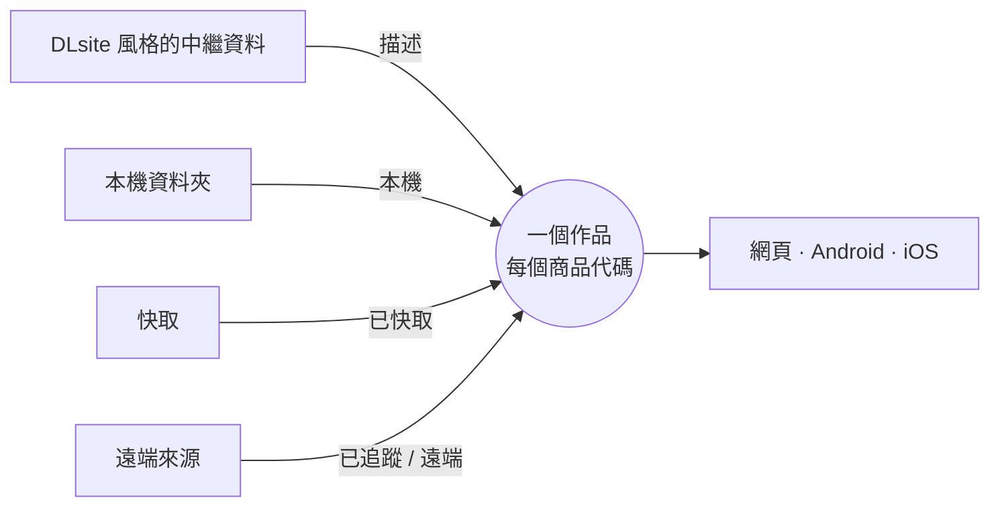

<p align="center">
  
</p>

<h1 align="center">Kikoto</h1>

<p align="center">
  <b>你購買的音訊作品，無論來自哪個資料夾、快取或來源，都集中在同一個媒體庫。</b><br>
  本機優先、可自行架設的媒體庫、歌詞工坊與播放器。
</p>

<p align="center">
  <a href="../../README.md">English</a> ·
  <a href="README.zh-Hans.md">简体中文</a> ·
  <a href="README.zh-Hant.md">繁體中文</a> ·
  <a href="README.ja.md">日本語</a> ·
  <a href="README.ko.md">한국어</a>
</p>

<p align="center">
  <a href="https://github.com/yexca/kikoto/releases"></a>
  <a href="https://kikoto.yexca.net"></a>
  <a href="https://hub.docker.com/r/yexca/kikoto"></a>
  <a href="../../LICENSE"></a>
</p>

Kikoto 為每個作品只保留一筆項目，以商品代碼為索引，並把 DLsite 風格的中繼資料、本機資料夾、可重建的快取，以及相容 Kikoeru 的遠端來源附加其上。它在你自己的伺服器上執行，可用任何瀏覽器，以及 Android 與 iOS 應用程式開啟。

<p align="center">
  
</p>

> [!NOTE]
> Kikoto 僅是可自行架設的軟體，不提供任何服務或內容。它的設計目的僅是整理你自己購買的 DLsite 作品；請參閱[免責聲明](#免責聲明)。

## 特色亮點

<table>
  <tr>
    <td width="50%" valign="top">
      <h3>📚 一個媒體庫，多個位置</h3>
      本機、快取、已追蹤與遠端的檔案，都是同一個作品的不同狀態。可以使用單一資料目錄，也可以每顆磁碟各用一個<b>儲存池</b>，並用<b>編輯檔案</b>把分散的副本集中到同一個資料夾。
    </td>
    <td width="50%" valign="top">
      <h3>🌐 遠端來源</h3>
      瀏覽相容的來源、<b>追蹤</b>它們的目錄樹、<b>快取</b>媒體以供播放，或將經過審核的檔案<b>取得</b>到你的媒體庫。
    </td>
  </tr>
  <tr>
    <td width="50%" valign="top">
      <h3>🏷️ 以你的語言呈現中繼資料</h3>
      標題、標籤、社團、聲優與本機檔案都依語言各自記錄名稱，每位使用者可以選擇自己的語言。編輯者可以修正標題、封面、標籤、製作名單與合集內容。
    </td>
    <td width="50%" valign="top">
      <h3>💬 歌詞，可轉寫也可翻譯</h3>
      依音軌與語言保存歌詞，用語音辨識轉寫音軌，並用 LLM 翻譯。每個結果都須經過審核，而 <b>Kikoto Helper</b> 可在本機執行這兩項工作。
    </td>
  </tr>
  <tr>
    <td width="50%" valign="top">
      <h3>🎧 聆聽與資料面板</h3>
      常駐的播放器，播放進度會在各個裝置間同步，另在<b>資料面板</b>提供收聽日曆、年度報告與口味檔案。
    </td>
    <td width="50%" valign="top">
      <h3>🔔 訂閱與智慧清單</h3>
      追蹤社團、系列與聲優的新作，並讓智慧清單依標籤自動填入作品。
    </td>
  </tr>
</table>

掃描、同步、檔案編輯與 AI 任務都以工作流程執行，可在活動中追蹤；角色決定誰能瀏覽、取得、編輯與管理；所有狀態都存放在同一個 SQLite 資料庫中。應用程式的 APK 與 IPA 附加在每個[發佈版本](https://github.com/yexca/kikoto/releases)上。

## 運作方式

中繼資料描述一個作品；檔案來源只說明它的音訊在哪裡。兩者都附加到同一個作品上，因此快取、取得或翻譯都不會建立第二個作品。請參閱[核心邊界](../architecture/core-boundaries.md)。



## 快速開始

映像檔可在 `linux/amd64` 與 `linux/arm64` 主機上執行，包括 ARM NAS 裝置與 64 位元 Raspberry Pi OS。使用 Docker Compose 時，將 [`docker-compose.yml`](../../docker-compose.yml) 放進一個空目錄，把你的作品資料夾加入 `data/`，然後啟動 Kikoto：

```sh
mkdir config cache data
docker compose up -d
```

開啟 <http://127.0.0.1:7655>，輸入 `docker compose logs kikoto` 中的設定權杖，並建立管理員。接著 **設定媒體庫** 會執行首次掃描。在 Windows 上，[Kikoto Helper](https://github.com/yexca/kikoto-helper)會為你完成這一切。[快速開始](../user/zh-Hant/getting-started.md)涵蓋每個步驟。

> [!WARNING]
> 預設的連接埠對應會監聽每個主機網路介面。請將它綁定到回送位址、使用 VPN，或在前面加上受保護的反向代理；請參閱[安全性](../operations/security.md)。

升級前請備份 `config/`，然後執行 `docker compose up -d --pull always`，並閱讀[發佈說明](../history/index.md)。`.env` 中的設定請參閱 [Docker](../operations/docker.md#configure-with-env)。

## 文件

- [使用者指南](../user/index.md)：媒體庫、來源、歌詞、播放、訂閱與設定。
- [維運](../operations/configuration.md)：設定並維運執行個體。
- [架構](../architecture/index.md)：資料與系統邊界。
- [貢獻](../../CONTRIBUTING.md)、[本機開發](../development/local-dev.md)與[測試](../development/testing.md)。
- [安全性](../../SECURITY.md)與[隱私](../../PRIVACY.md)，包括如何回報安全漏洞。
- [文件索引](../README.md)：所有公開文件。

## 免責聲明

- Kikoto 僅是軟體。本專案不代管、販售、提供或散布音訊作品、中繼資料或媒體檔案。
- 它的設計目的僅是用於你本人購買的 DLsite 作品。請遵守你所連接的商店、來源與 AI 服務的條款。
- 公開示範只會顯示全年齡且永久免費的作品。
- Kikoto 與 DLsite 或 Kikoeru 沒有隸屬關係，也未獲其背書；提及它們的名稱僅用於說明相容性。
- 每個執行個體的擁有者須對其使用的來源與服務，以及加入的檔案負責。

## 授權

Copyright (C) 2026 yexca. Kikoto 是依 [GNU Affero General Public License v3.0](../../LICENSE) 授權的自由軟體，且不附帶任何保證。
