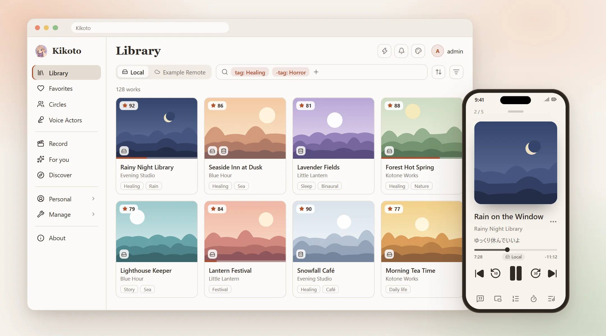

<p align="center">
  
</p>

<h1 align="center">Kikoto</h1>

<p align="center">
  你購買的每一部音訊作品，都集中在你自己架設的同一個媒體庫。
</p>

<p align="center">
  <a href="../../README.md">English</a> ·
  <a href="README.zh-Hans.md">简体中文</a> ·
  <a href="README.zh-Hant.md">繁體中文</a> ·
  <a href="README.ja.md">日本語</a> ·
  <a href="README.ko.md">한국어</a>
</p>

<p align="center">
  <a href="https://github.com/yexca/kikoto/releases"></a>
  <a href="https://kikoto.yexca.net"></a>
  <a href="https://hub.docker.com/r/yexca/kikoto"></a>
  <a href="../../LICENSE"></a>
</p>

<p align="center">
  
</p>

Kikoto 為每個作品只保留一筆項目，以 DLsite 商品代碼為索引，無論它的檔案位於本機資料夾、另一顆磁碟、快取，還是遠端來源。它在你自己的伺服器上執行，可用任何瀏覽器，以及 Android 與 iOS 應用程式開啟。

> [!NOTE]
> Kikoto 僅是可自行架設的軟體，不提供任何服務或內容。它的設計目的僅是整理你自己購買的 DLsite 作品；請參閱[免責聲明](#免責聲明)。

## 特色亮點

- **媒體庫**：單一資料目錄，或每顆磁碟各用一個儲存池；可依標題、社團、聲優、標籤或製作人員搜尋，並用 **管理檔案** 把作品分散的副本集中到同一個資料夾。
- **發現**：你訂閱的社團、系列與聲優的新作、DLsite 排行榜及其歷史記錄，以及從你自己的媒體庫抽選作品的 **為你推薦**。
- **播放**：單一播放器，播放進度會在各個裝置間同步；瀏覽器無法播放的格式由伺服器端轉換；收聽日曆與報告則在 **資料面板** 中。
- **歌詞**：依音軌與語言保存 LRC、SRT、WebVTT 與 ASS，並提供語音辨識轉寫，以及歌詞、標題、標籤與檔名的 AI 翻譯；[Kikoto Helper](https://github.com/yexca/kikoto-helper) 可在本機執行這兩項工作。
- **中繼資料**：依語言記錄名稱，每個帳號可選擇自己的語言，並提供標題、封面、標籤、製作名單與合集的編輯器。
- **遠端來源**：瀏覽相容 Kikoeru 的來源，再 **追蹤**、**快取** 或 **取得** 你想要的內容。
- **家庭共用**：以角色決定誰能瀏覽、取得、編輯與管理，長時間的任務則以工作流程執行，可追蹤也可重試。

[使用者指南](../user/index.md)會說明每一項功能。

## 安裝

映像檔可在 `linux/amd64` 與 `linux/arm64` 主機上執行，包括 ARM NAS 裝置與 64 位元 Raspberry Pi OS。將 [`docker-compose.yml`](../../docker-compose.yml) 放進一個空目錄，把你的作品資料夾加入 `data/`，然後啟動 Kikoto：

```sh
mkdir config cache data
docker compose up -d
```

開啟 <http://127.0.0.1:7655>，輸入 `docker compose logs kikoto` 中的設定權杖，並建立管理員；**設定媒體庫** 會執行首次掃描。每個步驟請參閱[快速開始](../user/zh-Hant/getting-started.md)。

- **Windows**：[Kikoto Helper](https://github.com/yexca/kikoto-helper) 會為你部署並管理 Kikoto。
- **Android 與 iOS**：APK 與未簽署的 IPA 附加在每個[發佈版本](https://github.com/yexca/kikoto/releases)上。
- **升級**：備份 `config/`，執行 `docker compose up -d --pull always`，並閱讀[發佈說明](../history/index.md)。

> [!WARNING]
> 預設的連接埠對應會監聽每個主機網路介面。請將它綁定到回送位址、使用 VPN，或在前面加上受保護的反向代理；請參閱[安全性](../operations/security.md)。

## 文件

- [使用者指南](../user/index.md)與[維運](../operations/configuration.md)
- [架構](../architecture/index.md)，從[核心邊界](../architecture/core-boundaries.md)開始
- [貢獻](../../CONTRIBUTING.md)、[本機開發](../development/local-dev.md)與[測試](../development/testing.md)
- [安全性](../../SECURITY.md)與[隱私](../../PRIVACY.md)
- [文件索引](../README.md)

## 免責聲明

- Kikoto 僅是軟體。本專案不代管、販售、提供或散布音訊作品、中繼資料或媒體檔案。
- 它的設計目的僅是用於你本人購買的 DLsite 作品。請遵守你所連接的商店、來源與 AI 服務的條款。
- 公開示範只會顯示全年齡且永久免費的作品。
- Kikoto 與 DLsite 或 Kikoeru 沒有隸屬關係，也未獲其背書；提及它們的名稱僅用於說明相容性。
- 每個執行個體的擁有者須對其使用的來源與服務，以及加入的檔案負責。

## 授權

Copyright (C) 2026 yexca. Kikoto 是依 [GNU Affero General Public License v3.0](../../LICENSE) 授權的自由軟體，且不附帶任何保證。
